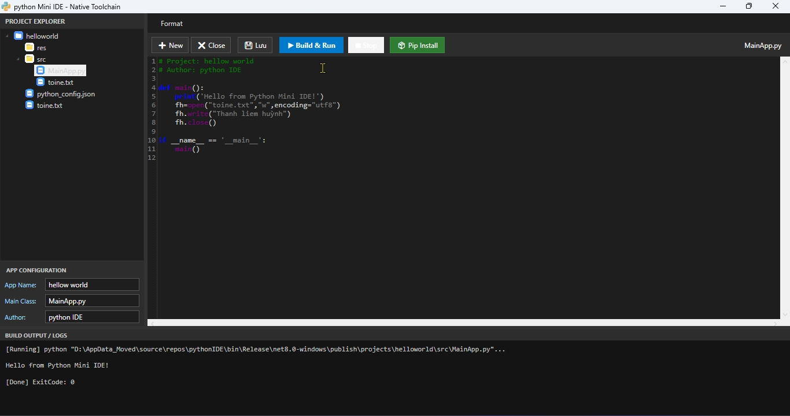

** CHƯƠNG TRÌNH CODE PYTHON TRỰC QUAN SỬ DỤNG MÔI TRƯỜNG PYTHON NGUYÊN MẪU **
* Yều cầu máy cài đặt .Net runtime
* Chạy và tạo project ngay tại thư mục file chạy
* có tích hợp sẵn nút cài thư viện, chỉ cần gõ tên gói thư viện cần cài đặt, cài vào môi trường python của windows
* Tối giản, đơn giản và tiện dụng
